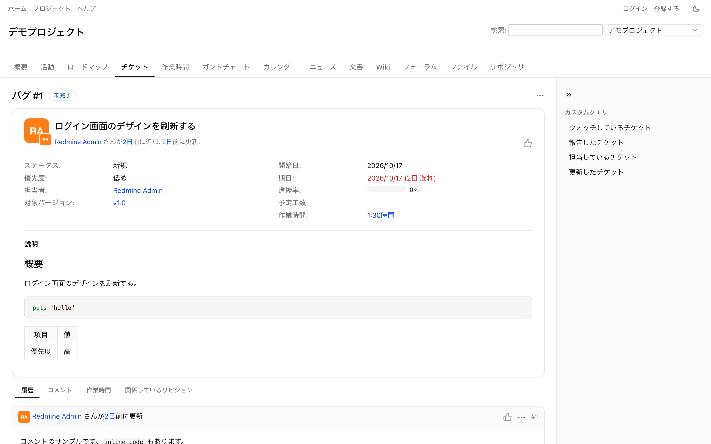
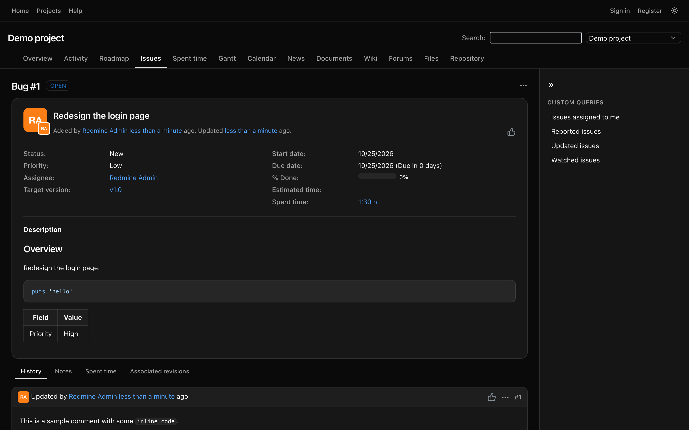
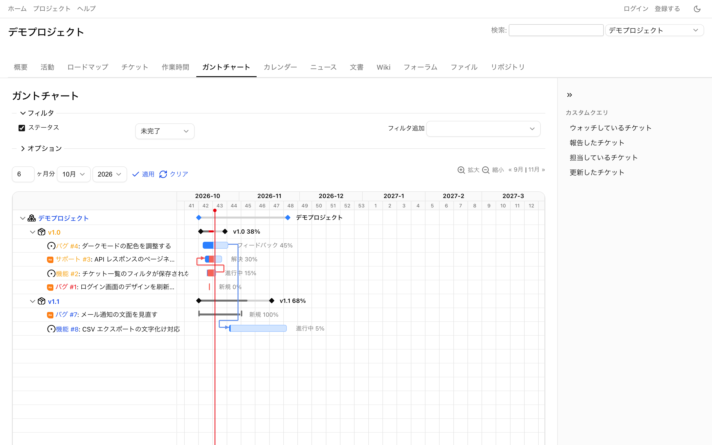
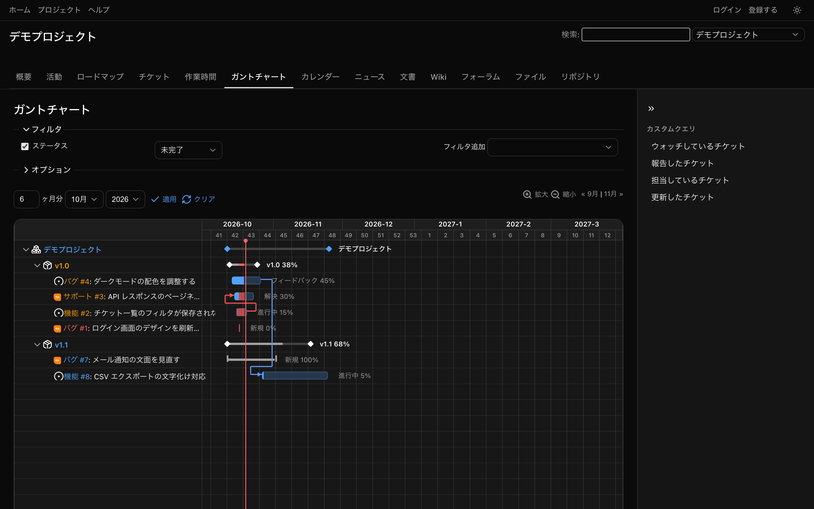
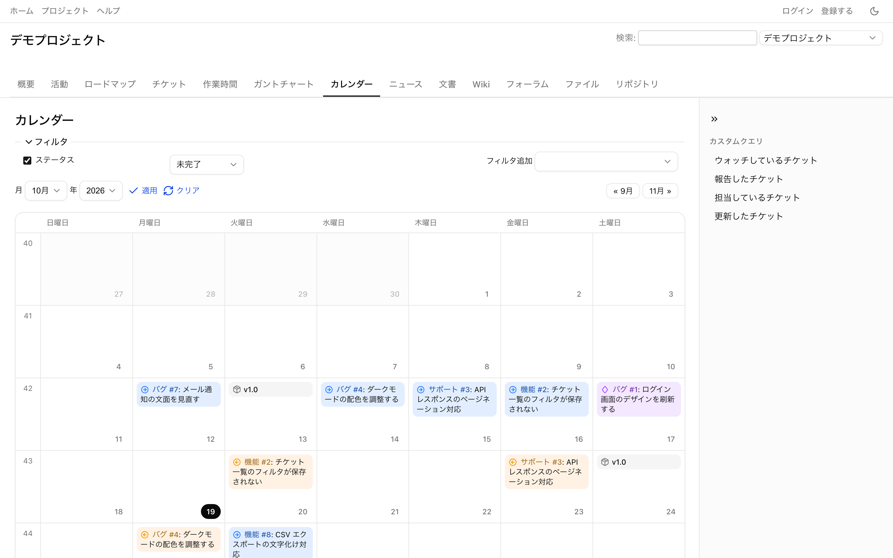
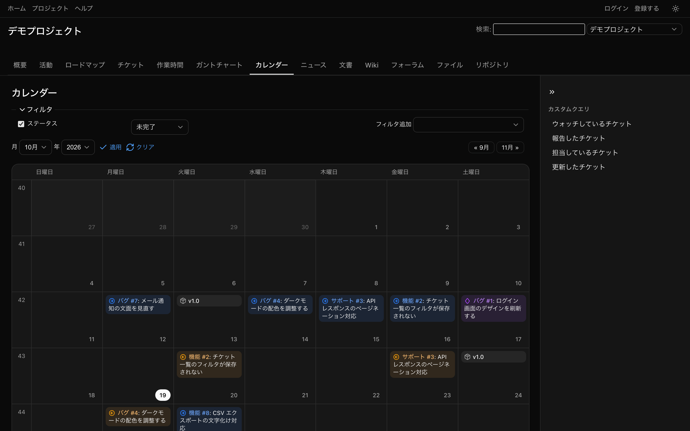

# Redmine shadcn theme

[shadcn/ui](https://ui.shadcn.com/) inspired theme for Redmine 6. (Unofficial — not affiliated with shadcn/ui.)

- shadcn/ui のデザイントークン（neutral）を Redmine の画面に適用
- ライト / ダークモード（OS 設定に追従、トップメニューのボタンで切り替え）
- アイコンを [Lucide](https://lucide.dev/) に差し替え
- チケット・ガントチャート・カレンダー・作業時間・ロードマップ・管理画面などに対応
- 確認バージョン: Redmine 6.1.5 / 7.0.2


## スクリーンショット

| | ライト | ダーク |
|---|---|---|
| チケット |  |  |
| ガントチャート |  |  |
| カレンダー |  |  |

## インストール

[Releases](https://github.com/techolve/redmine-shadcn-theme/releases) から `redmine-shadcn-theme-v*.zip` をダウンロードして、Redmine の `themes/` に展開する（`themes/shadcn/` ができる）。

```sh
cd /path/to/redmine/themes
unzip redmine-shadcn-theme-v0.2.0.zip
```

または git で clone する。

```sh
cd /path/to/redmine/themes
git clone https://github.com/techolve/redmine-shadcn-theme.git shadcn
```

Redmine を再起動して、`管理` → `設定` → `表示` → `テーマ` で **Shadcn** を選択。

## 開発

```sh
npm install
docker compose up -d                       # Redmine 6 → http://localhost:3000
docker compose --profile redmine7 up -d    # Redmine 7 も起動 → http://localhost:3001
docker compose exec -T redmine bundle exec rails runner - < src/tools/seed.rb   # サンプルデータ（admin / admin1234）。7 は redmine を redmine7 に
npm run reload                             # アイコンと CSS をビルドして Redmine を再起動
npm run package                            # Release 用の zip を .dist/ に作る
```

Redmine 6 はアセットを起動時に処理するため、CSS を変更したら再起動が必要です（`npm run reload`）。

> テーマ直下の `src/` 以外のフォルダは Redmine がアセットとして配信します。ビルド用のファイルは必ず `src/` に置いてください。

### 構成

```
src/                  ソース一式（Redmine は src/ を配信しない）
  tokens.css          shadcn のデザイントークン（色を変えるならここ）
  base.css            文字・リンク・見出し
  icons.css           SVG アイコンの色・線の太さ
  layout.css          ヘッダー・メニュー・サイドバー・フッター
  forms.css           入力欄・ボタン・ログイン
  components.css      テーブル・タブ・フラッシュ・ページネーション・Wiki
  issues.css          チケット詳細・履歴
  views.css           作業時間・管理画面・エディタ・jQuery UI など
  gantt.css           ガントチャート（ReUI の Gantt を参考にしたデザイン）
  calendar.css        カレンダー（ReUI の Event Calendar を参考にしたデザイン）
  redmine7.css        Redmine 7 で変わった部品（トップメニュー・アカウントメニューなど）
  dark.css            ダークモードの追加調整・シンタックスハイライト・切り替えボタン
  tools/build-icons.mjs  Redmine のアイコン名 → Lucide の対応表。images/icons.svg を生成
  tools/seed.rb       ローカル確認用のサンプルデータ
  tools/package.sh    Release 用の zip を作る
stylesheets/          ビルド結果（Redmine が読み込む。コミットする）
images/icons.svg      ビルド結果（Lucide のアイコンスプライト。コミットする）
javascripts/theme.js  ダークモード切り替え・ガントの行の高さと横幅の調整
```

### アイコンを変えたいとき

[src/tools/build-icons.mjs](src/tools/build-icons.mjs) の対応表を編集して `npm run build`。対応表にない Redmine のアイコンは標準のものが使われます。

### 本体 CSS の読み込み順に注意

`jstoolbar.css` と `context_menu.css`（Redmine 7 は `dropdown.css` と `gantt.css` も）はテーマより後に読み込まれるため、上書きするときは `div#context-menu` や `#content` を付けて詳細度を上げています。

### ローカルで 6 と 7 を同時に開くとき

ブラウザの Cookie はポート番号を区別しないので、`localhost:3000` と `localhost:3001` に同時にログインするとセッションが衝突します。片方は `127.0.0.1:3001` のように別のホスト名で開いてください。

## Credits

- Design tokens: [shadcn/ui](https://ui.shadcn.com/) (MIT)
- Icons: [Lucide](https://lucide.dev/) (ISC)
- Gantt / calendar design inspired by [ReUI](https://reui.io/components/gantt)
